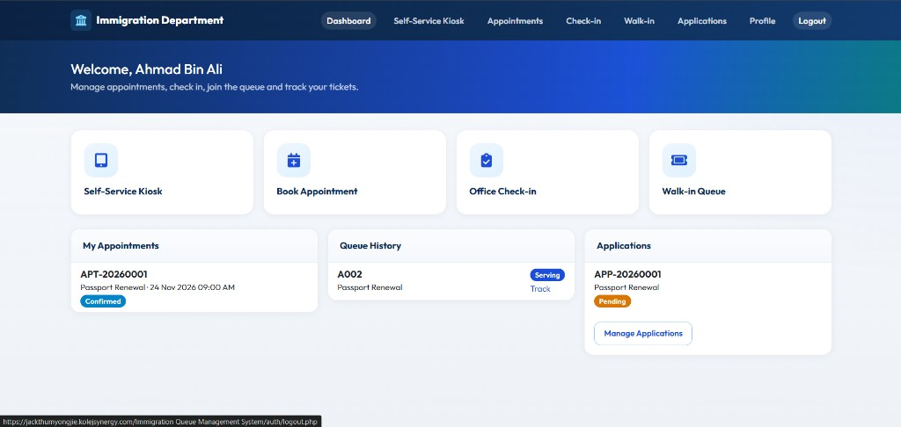
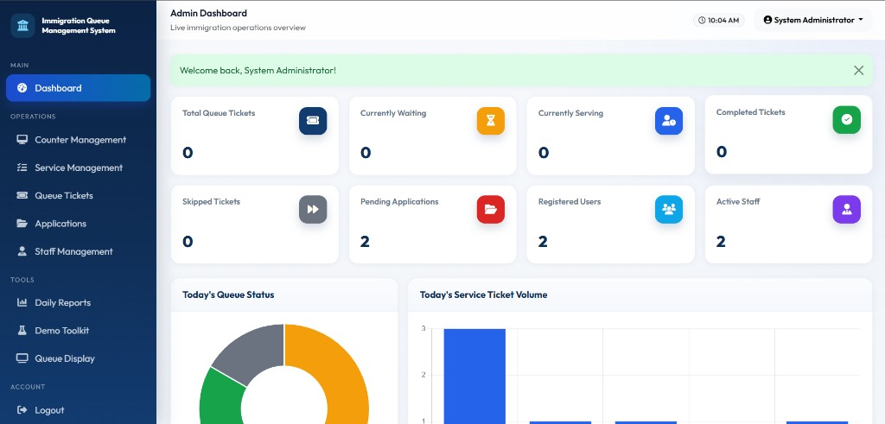
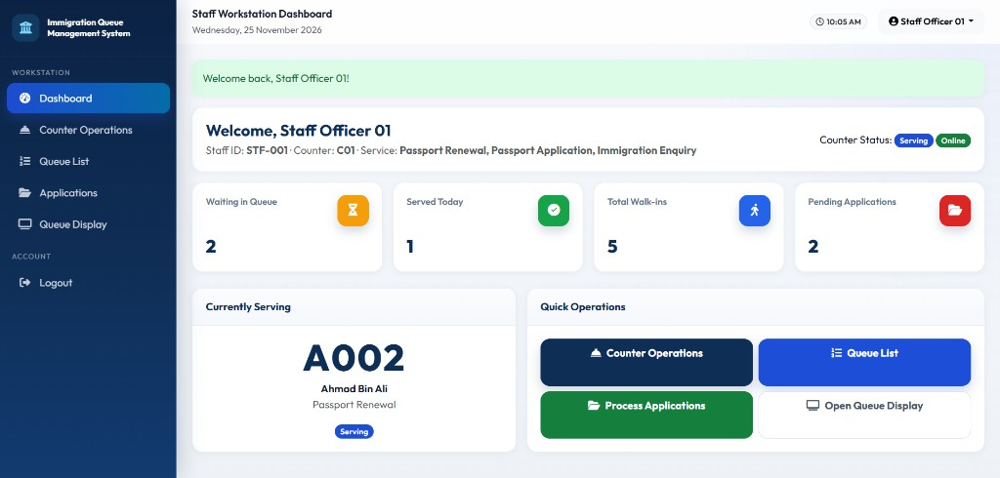

# Immigration Queue Management System (IQMS)

PHP / MySQL immigration office queue system with **Admin**, **Staff**, and **Public** roles — appointments, walk-in tickets, counter operations, live display board, and applications.

## Quick start (XAMPP)

1. Place the project under your XAMPP `htdocs` folder.
2. Copy `config/database.example.php` to `config/database.php` and fill in **your own** MySQL settings (never commit real production secrets).
3. Start **Apache** and **MySQL** in XAMPP.
4. Import the schema (pick one):
   - `php database/install.php`
   - or phpMyAdmin → Import → `database/immigration_queue_system.sql`
5. Open the project URL in your browser (encode spaces in the folder name if needed).
6. Sign in with a seed account from the login page, or register a Public user.
7. Staff: use **Counter Operations**; open **Queue Display** on another screen.
8. Public: use Kiosk / Walk-in / Appointment / Check-in, then **Live Tracker**.

> Database host, port, name, username, and password live only in `config/database.php`. Do not publish them in this README or in screenshots of config files.

## Screenshots

| Public dashboard | Admin dashboard |
|:---:|:---:|
|  |  |

| Staff workstation |
|:---:|
|  |

## Features

- Three roles with session login and CSRF protection
- Service & counter management, staff assignment and service permissions
- Online appointment booking (service → date → time slot) and cancel
- Office check-in: appointment reference → queue ticket
- Walk-in registration and self-service kiosk
- Staff counter ops: Call Next / Start Serving / Recall / Complete / Skip
- Public queue display board (female TTS; silent on Call Next, announce on Start Serving / Recall)
- Live Mobile Tracker with auto refresh (Waiting → Serving → Finished)
- Application submit, secure file upload, Admin / Staff review
- Admin charts, daily reports, demo toolkit
- Responsive Bootstrap 5 UI

## Folder structure

```
Immigration Queue Management System/
├── admin/                 Admin panel
├── staff/                 Staff workstation
├── public/                Public / visitor pages
├── display/               Queue display board
├── auth/                  Login, register, logout
├── assets/                CSS & JS
├── config/                App & database config (keep private)
├── database/              SQL + install / check scripts
│   ├── immigration_queue_system.sql
│   ├── cpanel_import.sql
│   ├── install.php
│   └── final_check.php
├── docs/screenshots/      README images
├── includes/              Helpers & layout
├── uploads/applications/  Uploaded documents
└── index.php              Landing page
```

## 1. Local setup

1. Copy the project into `htdocs`.
2. Configure `config/database.php` for your machine only.
3. Start Apache + MySQL.
4. Import SQL with `install.php` or phpMyAdmin.
5. Open the site and log in.

Seed demo logins are listed on the **Login** page (click a demo button to autofill). Change those passwords before any shared or production use.

## 2. Typical workflow

1. **Admin** sets up services, counters, and staff.
2. **Public** books an appointment, walks in, or checks in at the office.
3. Visitor receives a **queue ticket** and may open **Live Tracker**.
4. **Staff** → Counter Operations → **Call Next** (board: NOW CALLING, no voice).
5. **Start Serving** or **Recall** (board can announce with female TTS).
6. **Complete** or **Skip** → tracker shows Finished.
7. Optional: Public submits an **application**; Staff / Admin process it.

### Status meaning

- **Waiting** — in queue
- **Serving** — at counter (called only if service not started yet)
- **Completed / Skipped / Cancelled** — closed

## 3. Queue Display & voice

Open `display/queue_board.php` on a TV / second browser.

- Click once to unlock browser audio.
- Use the sound toggle on the board.
- Speech runs on **Start Serving** and **Recall** only.

## 4. Live Tracker

From the ticket page, or `public/live_tracker.php` with the ticket reference.

Updates about every 1.5 seconds without manual refresh.

## 5. Hosting deploy (e.g. cPanel)

1. Create a MySQL database and user in the host panel; grant privileges.
2. Upload the project to `public_html` (or a subfolder).
3. Put **your** production credentials only in `config/database.php`.
4. In phpMyAdmin, **select your database first**, then import `database/cpanel_import.sql`.
5. Make `uploads/` and `uploads/applications/` writable.
6. Visit your domain; base URL is detected from the folder path.

Never paste real DB passwords, panel usernames, or recovery keys into public docs or Git.

## 6. Helper scripts

| File | Purpose |
|------|---------|
| `database/install.php` | Local SQL import |
| `database/final_check.php` | Smoke test of core queue flow |
| `database/clear_queue.php` | Clear queue demo data (use carefully) |
| `admin/demo_toolkit.php` | Presentation helpers |

## System flow

```
Ticket created → Waiting → Call Next → Start Serving → Complete/Skip
                              ↓              ↓
                         Display board   Live Tracker
```

## Security notes

- Role-based access (`admin` / `staff` / `public`)
- Passwords hashed with `password_hash()`
- Session timeout and CSRF on forms / AJAX
- Uploads limited to PDF / JPG / PNG (max 5MB)
- Keep `config/database.php` out of public repos when it holds real secrets
- Rotate demo passwords before deployment

## Requirements

- PHP 8+ with PDO MySQL
- MySQL / MariaDB
- Modern browser (Web Speech API for display TTS)
- Timezone configured in `config/database.php`

## License

This project is licensed under the [MIT License](LICENSE).